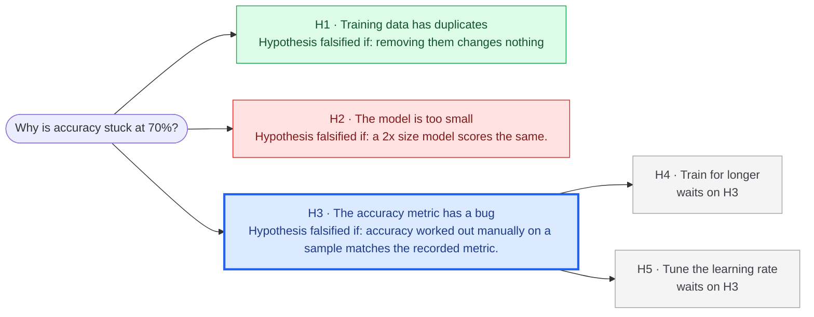
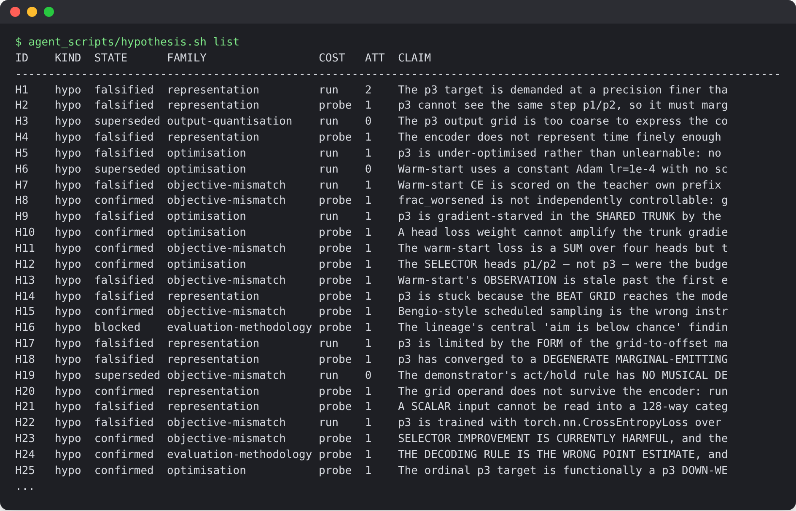
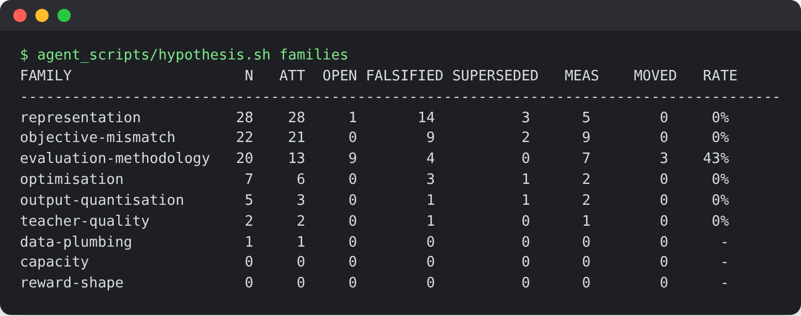

# research-loop

*Extracted by Claude Opus 5 from a private research system I built and ran for four weeks. More on that below.*

An autonomous AI research agent framework: 6 skills (Markdown instruction files in `agent/`) and 5 shell
scripts (in `bin/`), designed to run inside an existing coding agent harness. I used Claude Code with Opus 5.

You give it a research problem and a quantifiable target to hit, written down in a
[North Star file](examples/NORTH_STAR.md) (say "median error below 0.30"). It turns the problem into a
structured hypothesis graph: every hypothesis is a node, with dependencies mapped out as edges. The agent works through the graph on its own, testing hypotheses, logging every result, and raising the
target each time it clears it.



Each node is a hypothesis, with the result that would prove it wrong.

- **Green:** tested, and it held up.
- **Red:** tested and proven wrong.
- **Blue:** up next. Two other hypotheses depend on it, so it gets tested first.
- **Grey:** waiting for something it depends on.

## Key terms

| Term | Meaning |
|---|---|
| **Agent** | An AI coding agent that can run shell commands (I used Claude Code). Its instructions are in `agent/`; you supply the agent itself. |
| **Hypothesis** | A testable claim about the problem, like "the accuracy metric has a bug". |
| **Falsifier** | The specific result that would prove a hypothesis wrong, written down *before* it's tested. |
| **Dependency** | Hypothesis 4 depends on Hypothesis 3 if Hypothesis 4 is only worth testing once Hypothesis 3 has been settled. |
| **Root node** | A hypothesis that many other hypothesise depend on. Settling it first unblocks the most work and therefore makes it more valuable |
| **Settled** | Confirmed (the falsifier didn't happen) or falsified (it did). |
| **Probe / run** | The two test costs. A probe is an experiment that settles a hypothesis locally, in minutes. A run needs the expensive resource (GPUs, say) for hours. |
| **Goal** | The definition of success, kept in a goal file (`NORTH_STAR.md`) as thresholds on your metrics. |
| **Journal** | A log of everything that happened. Lines are only ever added, never changed. |

## How it works

The agent wakes up, reads the graph and the journal (checks it's state), does the next piece of work, writes down what
happened, and stops. It sets its own wake-up time before it stops, based on what's in flight: "this
experiment will finish in about two hours, so wake the next orchestrator then". A small heartbeat script,
run every few minutes by cron or launchd, starts the agent once that time comes round. Everything lives in
plain files under version control, so a fresh agent with no memory can pick up exactly where the last one
left off.

1. **Generate hypotheses.** After each result, the agent writes down hypotheses that could explain it. Each
   one has to cite the result that prompted it (a journal entry or a file and line), say which metric it
   expects to move, list any hypotheses it depends on, and give its falsifier. Without a falsifier it is
   refused programatically. A similarity check flags near-duplicates of hypotheses already in the graph.
2. **Choose what to test.** `hypothesis.sh next` ranks the open hypotheses: ones whose dependencies are
   settled come first, then whichever unblocks the most others, then probes before runs, then the area
   that's had the fewest attempts so far, so effort doesn't pile up in one place.
3. **Test it.** The agent marks the hypothesis as being tested, runs the experiment, and records the outcome
   along with the evidence. Falsified is final. Each hypothesis gets at most three attempts. If it can't be
   decided yet it's marked blocked, and reopening it needs a new reason, not just another try.
4. **Raise the goal.** `north_star.sh` checks the latest results against the goal. Once the goal has been
   met on two evaluations in a row, the agent may raise the thresholds, but only to levels it has already
   reached twice, and never lower them.

Every rule above is enforced by the tools themselves: break one and the command refuses and exits with an
error code, so the agent can't talk its way around them.

| Tool | What it holds | What it won't let you do |
|---|---|---|
| `bin/hypothesis.sh` | the hypothesis graph | add a hypothesis with no falsifier, revive a falsified one, or go past three attempts |
| `bin/north_star.sh` | the goal | lower the target, or raise it before it's been met twice |
| `bin/journal.sh` | the log of what happened | edit or delete anything already written |
| `bin/schedule_next.sh` | when the agent wakes next | sleep for less than 15 minutes or more than 16 hours |
| `bin/tick.sh` | the heartbeat that starts the agent | start it early, or run two at once; it also resumes or flags a session that died |

## Where it came from

I built the original to run an ML research project by itself for four weeks. In that time it worked
through 85 hypotheses, confirming 27 and disproving 32, and along the way it found bugs in its own
evaluation code. The original code is private, but the screenshots below some of what it produced. Claude
Opus 5 extracted the reusable core into this repo and stripped out everything specific to that research.
The agent's instructions came across too, rewritten as small modules in `agent/`.

Two views of the original's hypothesis graph. The first 25 of the 85
hypotheses in the registry, displayed using `hypothesis.sh list`, each with its family, state, test cost,
attempts and the start of its claim:



Then the same hypotheses grouped by family, displayed using `hypothesis.sh families`, showing how many were tried, falsified and set aside in each,
and how often a settled hypothesis actually moved a North Star number:



## What I'd do differently

**Explore better ranking heuristics.** The agent comes up with hypotheses far faster than it can test them.
In the three weeks the registry was in use it registered 85, about four a day, but only 14 were settled by a
full run (the multi-hour GPU experiments that actually drove progress). Most of the rest were settled by
cheap probes or set aside, and 19 were still waiting when the project ended. With generation outpacing
testing like that, choosing what to test next is where most of the value comes from, which makes ranking
the hardest part of the system.

Right now it ranks on four things: whether a hypothesis's dependencies are settled, how many other
hypotheses it unblocks, how cheap it is to test, and spreading attempts across families. That balances
exploration against the resources available reasonably well, but it leans towards breadth-first search and
can discourage digging deep into a promising chain of hypotheses. The next step would be to use the history
from the original run to build alternative ranking models and backtest them against the hypotheses it
actually settled, to see whether any weighting reaches the North Star sooner.

## Try it

```bash
./demo/walkthrough.sh   # a toy problem end to end, then four things it shouldn't allow (each one gets refused)
./tests/test_*.sh       # 388 checks, no network needed
```

To point it at your own problem, edit `config/loop.conf` (your metrics and the categories hypotheses can
belong to) and write a goal file (`examples/NORTH_STAR.md` is a worked one). To run it for real, set
`AGENT_CMD` in the same file to your agent and call `bin/tick.sh` every few minutes (`examples/` has a cron
line and a launchd plist). [agent/README.md](agent/README.md) explains how the agent's instruction files fit
together, and [docs/design.md](docs/design.md) has the reasoning behind each rule.

MIT licence.
